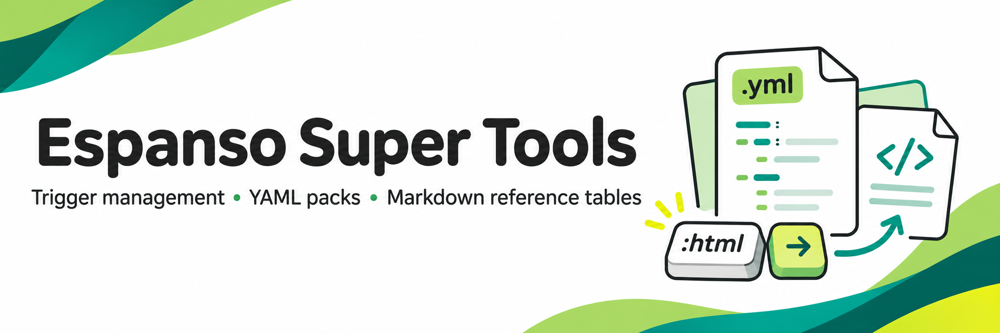

# Espanso Super Tools



A collection of scripts, tools, and optional YAML trigger packs to help you get more out of [Espanso](https://espanso.org/).

Create your own text shortcuts, build a named color vocabulary, insert HTML elements, generate a table from a form, and keep a readable reference of your triggers.

| Tool | What it does | Requirements |
| --- | --- | --- |
| [Shortcut index](espanso-shortcuts.py) | Generates a Markdown table of triggers, files, and your descriptions | Python 3.10+ and PyYAML |
| [HTML pack](Triggers/html.yml) | 102 HTML element snippets with useful cursor positions | Espanso 2 |
| [Table form](Triggers/table-generator.yml) | `:mdtable` generates a fixed field/value table plus styled HTML source | Espanso 2, Windows PowerShell |
| [Personal colors](Triggers/Triggers.md#custom-color-names) | `:mycolor` adds or updates named hex-code triggers | Espanso 2, Python 3.10+, tkinter, PyYAML |

See [pack installation and usage](Triggers/Triggers.md) and [practical ways to use Espanso](ways-to-use-espanso.md).

## Start with Espanso

Espanso expands typed triggers into text and can also open forms or run scripts. Install it using its [official instructions](https://espanso.org/install/).

On a standard Windows installation, press Win+R and open:

```text
%APPDATA%\espanso\match
```

This folder can contain multiple `.yml` files; the default is commonly `base.yml`. You do not need a file specifically named `match.yml`. Add a standalone pack as its own file, or add individual list entries beneath an existing `matches:` key. Never add a second `matches:` key to the same file.

Install only the packs you want. Do not copy multiple versions of the same trigger into the match folder: Espanso may show a chooser instead of opening a form directly.

## Generate your shortcut reference

1. Download the repository using **Code → Download ZIP** and extract it anywhere, such as Downloads. Keep the main toolkit outside your Espanso match folder; install optional packs separately.
2. Install Python 3.10+ so the `python` command works.
3. Open a terminal in the extracted toolkit folder and run:

   ```text
   python -m pip install -r requirements.txt
   ```

4. Double-click `triggers.bat`. Keep it beside `espanso-shortcuts.py`. The launcher can stay in Downloads; it reads `%APPDATA%\espanso\match` and writes `espanso-shortcuts.md` there.
5. Open the generated Markdown file and add descriptions in the final column. Run the launcher again after changing your triggers.

The index reads YAML `matches` entries, including `triggers:` aliases, and identifies files by relative path. It preserves descriptions for unchanged trigger/path pairs, adds new entries, and removes entries no longer present. Renaming a trigger or file changes its identity. Old stem-only descriptions migrate when the filename is unambiguous. The previous table is saved as `espanso-shortcuts.md.bak`.

For descriptions containing a literal pipe, write `\|`. Keep each description on one table row. Invalid YAML aborts generation without replacing the existing reference. The index lists files beneath the chosen folder; it does not resolve external imports, regex matches, or which app-specific matches are active.

For portable installations or macOS/Linux, run the script directly with your own directory (use `python3` if needed):

```text
python espanso-shortcuts.py --match-dir "PATH/TO/espanso/match"
```

The [committed reference](espanso-shortcuts.md) is an example generated from the included packs, including the extracted color form. Your local table will reflect your installed triggers.

## Personal color setup

Download [espanso-mycolor.zip](https://raw.githubusercontent.com/monapdx/Espanso-Super-Tools/main/Triggers/espanso-mycolor.zip) into your match folder, extract it there, and run `setup-windows.bat` inside the extracted folder. Restart Espanso and type `:mycolor`.

`mycolor.yml` defines the form. The separate `match/mycolors.yml` file stores colors created by it. See the [color instructions](Triggers/Triggers.md#custom-color-names) for updating an older installation.

## Verification

Run `python -m unittest discover -s tests -v` after installing requirements. Tests cover YAML indexing, aliases, embedded examples, descriptions, invalid files, and unique bundled triggers. Windows Espanso and PowerShell UI behavior still require a live smoke test.
